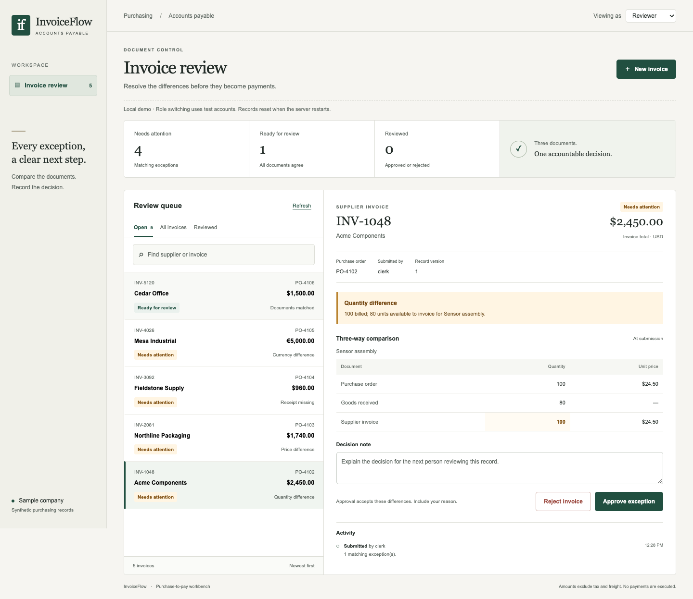
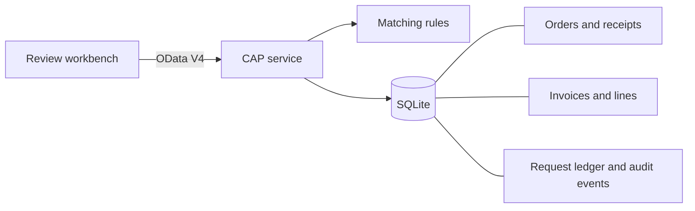

# InvoiceFlow

A purchase-to-pay review workbench built with **SAP CAP, Node.js and OData V4**. It compares supplier invoices with purchase orders and goods receipts, then puts the differences in front of a reviewer.



## Try it locally

Requires Node.js 22 or newer.

```sh
npm ci
npm start
```

Open **http://localhost:4004** and select **Load sample invoices**. The five synthetic invoices include a quantity difference, a price difference, a missing receipt, a currency difference and a clean match.

Select an invoice to inspect its documents. Add a note before approving or rejecting it. Switch to **AP clerk** to submit an invoice, or **Auditor** to inspect records without changing them. These are local test accounts, not a production sign-in system. The default database is in memory and resets on restart.

## What is implemented

- **Three-way matching.** Compare item quantities and unit prices; aggregate receipts and account for quantities on previously approved invoices. Money calculations use integer minor units.
- **Safe submission retries.** A request key and normalized payload hash identify repeat submissions. Reusing a key for different data or resubmitting a supplier invoice reference returns a conflict.
- **Review controls.** Server-side roles, a second-person check, required decision notes and version-checked updates protect the workflow. Concurrent decisions produce one transition.
- **An audit trail.** Each submission and decision writes an audit event in the same database transaction. Public entity endpoints are read-only.

A reviewer can accept a quantity or price exception with a recorded reason. Currency mismatches and quantities already consumed by approved invoices block approval. This is a deliberately small review policy; it does not execute payments.

## How it fits together



The UI uses native browser modules and CSS. CAP provides the actual OData metadata, queries and actions; there is no separate mock API behind the screenshot.

| Folder  | Contents                                               |
| ------- | ------------------------------------------------------ |
| `app/`  | Responsive review workbench                            |
| `db/`   | CDS entities and synthetic order/receipt fixtures      |
| `srv/`  | Submission, matching and decision handlers             |
| `test/` | Unit, HTTP integration and browser tests               |
| `docs/` | API, design decisions, scope and SAP integration notes |

## Checks

```sh
npm test                  # 25 unit and real HTTP integration tests
npm run check:model       # Compile CDS to SQLite SQL and OData V4 metadata
npx playwright install chromium
npm run test:ui           # Full workbench flow, including three viewport widths
npm run format:check
```

The tests cover retry collisions, duplicate invoices, permissions, immutable audit endpoints, decimal precision, concurrent reviews and competing approvals against the same received quantity. Browser checks exercise submission, rejection, approval and role switching. These are correctness checks, not production load tests.

## SAP integration status

**CAP and OData V4 are implemented and tested locally.** SAP BTP deployment and an ABAP upstream service are the next integration steps; neither is represented as completed.

- [BTP deployment path](docs/btp.md): HANA, authentication and Cloud Foundry configuration to validate with a real account.
- [ABAP integration design](docs/abap-integration.md): an upstream purchase-order service and its OData boundary.
- [API and example requests](docs/api.md)
- [Engineering decisions and limitations](docs/design.md)

The current scope is one organization, whole-item quantities, and USD/EUR/GBP with two-decimal prices. Tax, freight, currency conversion, credit notes and real ERP posting are outside the prototype. All supplier names and records are synthetic. This is an independent project, not an SAP product or SAP-endorsed implementation.

MIT license.
